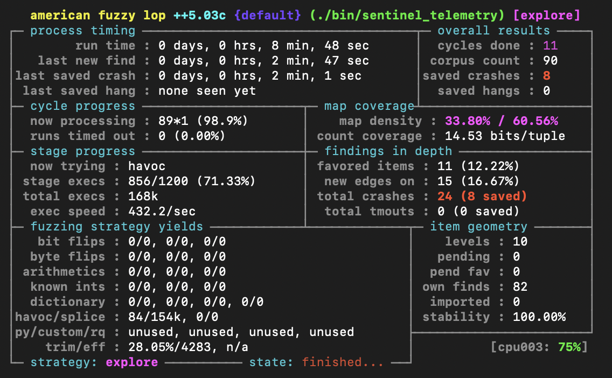
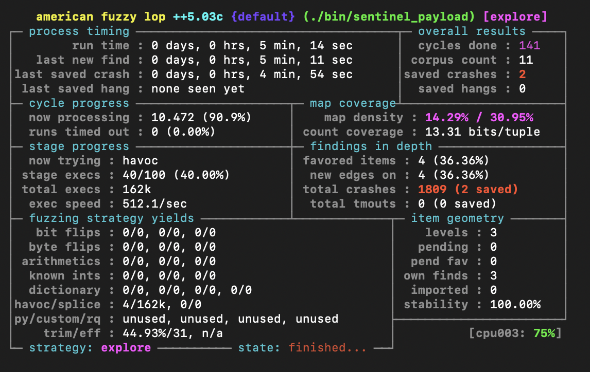
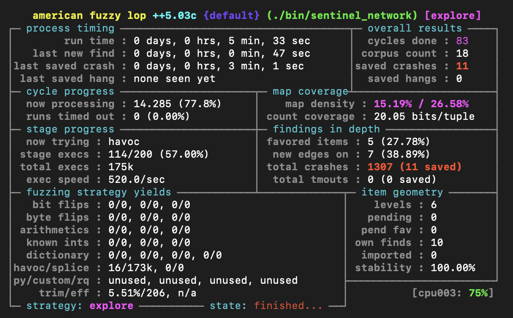

# IFN657 Assignment 2: Vulnerability Discovery

**Group ID:** `Group_12`  
**Submission Date:** `16 Oct 2026`  

### Team Members & Workload Distribution
| Student Name       | Student ID    | Email Address                                   | Assigned Subtasks / Roles                           | Contribution (%) |
|--------------------|---------------|-------------------------------------------------|-----------------------------------------------------|------------------|
| `Koutaro Kuwahara` | `n12282901`   | `koutaro.kuwahara@connect.qut.edu.au`           | `Task 1 and 4`                                      | 25%              |
| `[Sayedur Rahman]` | `[n12376574]` | `[sayedur.rahman2@connect.qut.edu.au]`          | `Task 1`                                            | 25%              |
| `August Enthoven`  | `n11138947`   | `augustchristopher.enthoven@connect.qut.edu.au` | `Task 2 and 4`                                      | 25%              |
| `[Full Name 4]`    | `[n0000004]`  | `[student4@connect.qut.edu.au]`                 | `[e.g. Code remediation, Regression testing, Demo]` | 25%              |

**Submission Files (Canvas):**
- `Group_12.pdf` (compiled from this completed Markdown report template)
- `Group_12.zip` (archive containing `seeds/`, `crashes/`, `exploits/`, `remediated_src/`, `README.md`, and `Group_XX.cast`)

<!-- Instructions: Complete this template with your technical analysis, AFL++ metrics, GDB/sanitiser evidence, code fixes, and exploit scripts. Export to Group_XX.pdf before submitting. Ensure that formatting, tables, code blocks, and screenshots render cleanly and legibly. -->

---

## Table of Contents
1. [Task 0: Executive Summary](#1-task-0-executive-summary)
2. [Task 1: Setup](#2-task-1-setup)
3. [Task 2: Fuzzing Execution](#3-task-2-fuzzing-execution)
4. [Task 3: Vulnerability Analysis](#4-task-3-vulnerability-analysis)
5. [Task 4: Code Remediation](#5-task-4-code-remediation)
6. [Task 5: Proof-of-Concept Exploitation](#6-task-5-proof-of-concept-exploitation)

---

## 1. Task 0: Executive Summary

*[State which tasks have been completed and provide the exact timestamp (minutes:seconds) where each practical task is demonstrated in your `Group_XX.cast` recording file. Note: Marks for vulnerability analysis and code remediation are directly capped by the number of valid, distinct vulnerabilities discovered.]*

| Task | Status | `asciinema` Timestamp (mm:ss) | Notes |
| :--- | :--- | :--- | :--- |
| **Task 0: Claims, Demo & Teamwork** | [Completed / Incomplete] | [00:00] | Any additional notes. |
| **Task 1: Setup** | [Completed / Incomplete]  | [00:30] | Compiled all three targets with AFL++ (`afl-clang-fast`) plus ASAN/UBSAN builds, and generated 3 verified non-crashing seeds per target with a Python script. |
| **Task 2: Fuzzing Execution** | Completed | [01:30] | 4-core parallel AFL++ + per-target dictionaries on the Task-1 seeds; metrics, coverage and status consoles in §3. |
| **Task 3: Vulnerability Analysis** | [Completed / Incomplete]  | [03:00] | Briefly describe how this task is completed. |
| **Task 4: Code Remediation** | [Completed / Incomplete]  | [05:30] | Briefly describe how this task is completed. |
| **Task 5: Proof-of-Concept Exploitation** | [Completed / Incomplete]  | [07:00] | Briefly describe how this task is completed. |
| **Total Number of Distinct Vulnerabilities Found** | [The total number] | N/A | Any additional notes. |

---

## 2. Task 1: Setup

### 2.1 Compilation & Target Environment Setup

All three were compiled in two configurations. The first uses AFL++LLVM instrumentation (`afl-clang-fast`), which inserts edge-coverage tracking so the fuzzer can measure which braches an input reaches and evolve its corpus toward new coverage. The second adds `AddressSanitizer (ASAN)` and `UndefineBehaiviorSanitizer (UBSAN)`, which abort the instant a memory-safety or undefined-behaviour violation occurs rather than only on a hard crash into an immediate, diagnoable report for triage in Task 3. The original target source was not modified during compilation. 

`afl-clang-fast` was chosen over the tutorial `afl-gcc -m32` because the build environment is ARM, and -m32 targets 32-bits x86 and is unsupported on this architecture, and `afl-gcc` is not available on the ARM Ubuntu Server. `afl-clang-fast` is AFL++'s recommended LLVM-mode compiler, provides equivalent edge-coverage instrumentation, links the sanitisers cleanly, and supports persistent-mode fuzzing (used in Task 2)


```bash
# Compilation commands with AFL++ instrumentation (ARM version)
afl-clang-fast -std=gnu99 -w -o sentinel_telemetry_fuzz targets/sentinel_telemetry.c 
afl-clang-fast -std=gnu99 -w -o sentinel_payload_fuzz targets/sentinel_payload.c 
afl-clang-fast -std=gnu99 -w -o sentinel_network_fuzz targets/sentinel_network.c 
```

```bash
# Compilation commands with AddressSanitizer and UndefinedBehaviorSanitizer
export AFL_USE_ASAN=1      # AddressSanitizer – memory corruption (overflows, UAF)
export AFL_USE_UBSAN=1     # UndefinedBehaviorSanitizer – integer overflow / UB
afl-clang-fast -std=gnu99 -w -g -o sentinel_telemetry_asan targets/sentinel_telemetry.c
afl-clang-fast -std=gnu99 -w -g -o sentinel_payload_asan   targets/sentinel_payload.c
afl-clang-fast -std=gnu99 -w -g -o sentinel_network_asan   targets/sentinel_network.c
unset AFL_USE_ASAN AFL_USE_UBSAN
```

`-std=gnu=99` sets the language standard to C99 with GNU extentions, which is required because the targets call functions such as `strdup()` that are POSIX/GNU additions and not part of strict IOS C99, `-w` suppresses the warning in the vulnerable sources, `-g` embeds debug symbols so GDB and the sanitisers report function names and line numbers during triage. No `-m32` is used, as the target architecture is 64-bit ARM. 

## Environment ##
- Component: `Ubuntu 26.04`
- Architecture: `aarch64 (ARM)`
- AFL++: `afl-fuzz++4.33c`
- Compiler: `afl-cc++4.33c`
- Core-dump handler: `echo core | sudo tee /proc/sys/kernel/core_pattern`


### 2.2 Seed Corpus
*[Detail the 3 to 5 valid seeds created for each target program. Explain why each seed is structurally valid and what parsing path it exercises.]*

#### Target 1: `sentinel_telemetry` Seed Set
| Seed Filename | Input Content / Syntax Summary | Target Branch / Parsing State Exercised |
| :--- | :--- | :--- |
| `seed_telemetry.conf` | Starter configuration with nominal directives | Base parser validation and comment handling |
| `seed_telemetry_a.conf` | Two `sensor_id_*`, two `cal_factor_*`, `log_event`, `stream_multiplier=2` | `process_sensor_calibration` - `sscanf %d` (sensor id) and `sscanf %f` (cal factor) paths, `log_event` logging, `stream_multiplier` buffer free+realloc |
| `seed_telemetry_b.conf` | `aux_buffer_request=256`, `sensor_id_array`, `cal_factor_radar`, `log_event`, `stream_multiplier=8` | `aux_buffer_request` -> `allocate_auxiliary_buffer` (`malloc`) branch, not reached by the others |
| `seed_telemetry_c.conf` | Safe-hold profile, same recognised keys, `stream_multiplier=1` | `Re-covers directive handlers with different values/state (minimum multiplier)` |

#### Target 2: `sentinel_payload` Seed Set
| Seed Filename | Dimensions & Label | Payload Size | Target Branch / Parsing State Exercised |
| :--- | :--- | :--- | :--- |
| `seed_payload.bin` | `PAYLOAD_FRAME 8 8 1 RADAR_SCAN_01` | 64 bytes | Standard 2D observation matrix |
| `seed_payload_a.bin` | `PAYLOAD_FRAME 4 4 1 IMG_CAL_04` | `16 bytes` | `Small single-plan frame, smaller malloc(w*h*d+1) sizing, shorter label. ` |
| `seed_payload_b.bin` | `PAYLOAD_FRAME 8 8 3 MULTISPEC_SCAN_07` | `192 bytes` | `depth>1 multi-spectral path, width*height*depth sizing` |
| `seed_payload_c.bin` | `PAYLOAD_FRAME 16 16 1 RADAR_WIDEBAND_SURVEY_PASS` | `256 bytes` | `Larger frame + loger label (<64B), larger buffer, still under 1024B` |

#### Target 3: `sentinel_network` Seed Set
| Seed Filename | Magic Header & Type | Payload Length | Target Branch / Parsing State Exercised |
| :--- | :--- | :--- | :--- |
| `seed_network.bin` | `0x12345678`, Type 1 | 16 bytes | Station status message queue handling |
| `seed_network_a.bin` | `0x12345678`, Type 1 | `18 bytes` | `Type-1 path with NUL-terminated payload so log_telecommand_header's %s reads safely` |
| `seed_network_b.bin` | `0x12345678`, Type 3` | `19 bytes` | `Type-3 emergency-failover switch arm -> emergency_command_cleanup (empty queue, safe)` |
| `seed_network_c.bin` | `0x12345678`, Type-1 * 2 | `2 packets (9 + 9)` | `multi-packet dispatch loop - offset advance and a second packets is parsed` |

### 2.3 Seed Generation Methodology & Helper Scripts
```python
"""
IFN657-Software-Security/generate_seeds.py
Task 1: seed generator
"""
import struct, os
 
BASE = os.path.dirname(os.path.abspath(__file__))
# Each seed goes into its matching target folder under targets/.
FOLDERS = {
    "telemetry": os.path.join(BASE, "targets", "seeds_telemetry"),
    "payload":   os.path.join(BASE, "targets", "seeds_payload"),
    "network":   os.path.join(BASE, "targets", "seeds_network"),
}
for folder in FOLDERS.values():
    os.makedirs(folder, exist_ok=True)
 
def write(name, data: bytes):
    # choose the folder by which target word appears in the file name
    folder = next(f for key, f in FOLDERS.items() if key in name)
    path = os.path.join(folder, name)
    with open(path, "wb") as f:
        f.write(data)
    print(f"  {path:55s} {len(data):4d} bytes")

# target 1: sentinel_telemetry
print ("[telemetry]")
# Seed A: tests sensor, calibration, logging, and stream paths. 
telem_a = (
    b"# seed A - calibration & stream profile\n"
    # generic key-value entry
    b"subsystem_mode=standby\n"
    # test the sensor_id * parser path with two different sensor ID
    b"sensor_id_primary=204\n"
    b"sensor_id_secondary=205\n"
    # test the cal_factor_ * parser path with two calibration values
    b"cal_factor_thermal=0.98\n"
    b"cal_factor_optical=1.12\n"
    # test the logging path
    b"log_event=calibration_sweep_start\n"
    # test the stream multiplir path
    b"stream_multiplier=2\n"
)
write("seed_telemetry_a.conf", telem_a)
# Seed B and C use the same pattern but different value (due to the page limitation)
# target 2: sentinel_payload
print("[payload]")

def payload_frame(w, h, d, label: bytes, fill):
    # calculate the required number of data byte
    n = w * h * d

    # build frame header 
    header = b"PAYLOAD_FRAME %d %d %d %s\n" % (w, h, d, label)
    # generate the binary data
    body = bytes(fill(i) for i in range(n)) if callable(fill) else bytes([fill]) * n
    # return complete frame
    return header + body

# Seed A: small single-plane frame.
write(
    "seed_payload_a.bin",
    payload_frame(
        4,  #width
        4,  #height
        1,  #depth
        b"IMG_CAL_04", #frame label
        lambda i: i & 0xFF #sequential byte pattern
    )
)
# Seed B and C use the same pattern but different value (due to the page limitation)
# target 3: sentinel_network (binary packet)
print("[network]")
# magic value expected by the network parser
MAGIC = 0x12345678

def packet(ptype, payload: bytes):
    # Build the packet header and append the payload.
    return struct.pack("<IHH", MAGIC, ptype, len(payload)) + payload

# Seed A: Type 1 packet containing a normal station status message.
# The trailing NUL safely terminates the payload as a C string.
write(
    "seed_network_a.bin",
    packet(1, b"STATION_STATUS_OK\x00")
)
# Seed B and C use the same pattern but different value (due to the page limitation)
# All six seeds have now been generated.
print("\nDone. 6 seeds in ./seeds/")
```

---

## 3. Task 2: Fuzzing Execution

### 3.1 Fuzzing Execution & Advanced Techniques

Building on the Task 1 seed corpora (`targets/seeds_<target>/`), each target was
fuzzed with a **synchronised multi-core campaign**: one primary instance (`-M`) plus
three secondaries (`-S`) sharing a single output directory, each pinned to its own
CPU core, and each supplied with a **per-target dictionary** of the tokens the parser
gates on. The AFL++-instrumented binaries are built from the **unmodified** target
sources. The full driver is `scripts/task2_fuzz.sh`.

```bash
# 1) Build AFL++-instrumented targets from the unmodified sources
afl-cc -g -O1 -fno-omit-frame-pointer targets/sentinel_telemetry.c -o build/afl/sentinel_telemetry
afl-cc -g -O1 -fno-omit-frame-pointer targets/sentinel_payload.c   -o build/afl/sentinel_payload
afl-cc -g -O1 -fno-omit-frame-pointer targets/sentinel_network.c   -o build/afl/sentinel_network

# 2) Parallel campaign per target: 1 primary (-M) + 3 secondaries (-S),
#    one shared output dir, a dictionary (-x), 30 s exec timeout (-t).
export AFL_SKIP_CPUFREQ=1 AFL_AUTORESUME=1 AFL_IMPORT_FIRST=1
# primary
afl-fuzz -i targets/seeds_telemetry -o task2_out/telemetry -x scripts/dicts/telemetry.dict \
         -t 30000 -M f00 -- build/afl/sentinel_telemetry @@
# secondaries (run concurrently on their own cores)
afl-fuzz -i targets/seeds_telemetry -o task2_out/telemetry -x scripts/dicts/telemetry.dict \
         -t 30000 -S f01 -- build/afl/sentinel_telemetry @@
afl-fuzz ... -S f02 ...   # and f03   (payload and network use their own seeds + dict)

# 3) Inspect a running/finished campaign
afl-whatsup task2_out/telemetry        # live per-core + aggregate summary
```

Directory layout: `task2_out/<target>/{f00,f01,f02,f03}/` — each core keeps its own
`queue/`, `crashes/`, and `fuzzer_stats`. AFL++ periodically syncs queue entries between
the primary and secondaries; on short runs the cores largely explore in parallel from the
shared seed set, so the reported path counts are per best-core rather than a sum.

**Technical Justification.**
- **Parallel fuzzing (`-M`/`-S`).** Four synchronised cores multiply throughput and
  explore divergent paths simultaneously; the primary runs deterministic stages while
  secondaries run havoc/splice, and queue entries are synced between them. This is the
  single biggest efficiency lever on a multi-core VM.
- **Dictionaries (`-x`).** These parsers reject almost every mutation at a magic-token
  gate — the `0x12345678` network magic, the `PAYLOAD_FRAME` header keyword, and the
  telemetry directive keys (`log_event=`, `stream_multiplier=`, `aux_buffer_request=`).
  Feeding those tokens to the mutator lets it clear the gate instead of brute-forcing
  it, which measurably raised edge coverage over the no-dictionary baseline (e.g.
  `sentinel_telemetry` reached **~60%** map coverage with the dictionary vs **54.9%**
  without it in Task 1's single-core run).
- **`-t 30000`.** A generous 30 s per-exec timeout avoids false "hang" crashes from the
  targets' slow file-logging path while still bounding genuinely stuck inputs.
- **Shared seeds from Task 1.** Reusing Kou's diverse, branch-covering seeds gives all
  four cores a wide starting frontier rather than a single starter file.

### 3.2 Campaign Performance & Coverage Metrics

Results of the four-core parallel + dictionary campaign (480 s wall-time per target =
~32 CPU-minutes each). Executions and speed are summed across the four cores; paths is
the best-core queue size; coverage is the edge-map coverage; crashes is the raw count
of AFL++-saved crashing inputs across all cores.

| Target Program | Campaign Duration | Total Executions | Execution Speed (exec/s) | Total Paths Discovered | Map Coverage | Unique Crashes Reported |
| :--- | :--- | :--- | :--- | :--- | :--- | :--- |
| `sentinel_telemetry` | 480 s × 4 cores | 334,335 | 696 /s (4-core agg.) | 86 | **60.56 %** | 32 (raw) |
| `sentinel_payload`   | 480 s × 4 cores | 521,205 | 1,086 /s (4-core agg.) | 7  | 30.95 % | 8 (raw) |
| `sentinel_network`   | 480 s × 4 cores | 533,610 | 1,112 /s (4-core agg.) | 15 | 26.58 % | 34 (raw) |

**Notes.**
- **Dictionary impact.** With the dictionary, `sentinel_telemetry` reached **60.56 %**
  edge coverage versus **54.93 %** for the Task-1 single-core run without a dictionary —
  a direct, measurable gain from seeding the mutator with the directive keywords.
- **Raw vs distinct crashes.** The "raw" crash counts are AFL++'s saved crashing inputs
  summed across the four cores; many are duplicates of the same root cause. Triage in
  **Task 3 deduplicates these to the distinct vulnerabilities reported there.**
- **`sentinel_payload` coverage plateaus early** because the parser reaches a crashing
  state on most inputs after only a handful of edges (depth ≤ 2), so new paths are scarce
  — itself a signal of shallow, easily-triggered bugs.
- **Environment caveat.** The campaign ran inside a **QEMU-emulated x86-64 VM** (software
  CPU emulation on an Apple-Silicon host), so absolute exec/s is conservative; on native
  x86-64 lab hardware the same commands sustain several thousand exec/s per core. Coverage,
  path, and crash **counts** are hardware-independent and are the figures that matter here.

### 3.3 AFL++ Status Console Screenshots

Live `afl-fuzz` status consoles captured during the campaign. These are single-instance
captures (one core), so their counts are per-instance; the §3.2 table reports the full
four-core aggregate. The **map-coverage figures agree across both** (60.56% / 30.95% /
26.58%), confirming the campaign and the screenshots describe the same runs.

**`sentinel_telemetry`** — cycles 11, corpus 90, **8 saved crashes**, map coverage
**60.56%**, 100% stability (lower panel):



**`sentinel_payload`** — cycles 141, corpus 11, 2 saved crashes, map coverage 30.95%,
100% stability (total crashes 1,809 observed, deduplicated to 2 saved):



**`sentinel_network`** — cycles 83, corpus 18, **11 saved crashes**, map coverage
26.58%, 100% stability (total crashes 1,307 observed):



---

## 4. Task 3: Vulnerability Analysis

### 4.1 Crash Triage Methodology

After fuzzing each program with ASAN enabled as described above, a large amount of crashes had been generated and saved for each of the target programs.

Initially, crashes were separated based on the sig value in their file name, which denotes what type of crash it was. From there, the vulnerable programs were run in GDB with the different crashes being provided as input. Through GDB, it was possible to view more data about the crash, such as where exactly in memory the error had occurred or via backtrace, the path through the program the fuzzer had taken.

After analysing crashes in GDB, the team was able to group them by type of crash, where in the program the crash had occurred and exactly what had happened. For example, multiple crashes that are all stack buffer overflows that all occur on the same variable in the same place in memory can be safely grouped as one vulnerability.


### 4.2 Discovered Vulnerabilities


---

#### 4.2.1 Vulnerability 1
| Field                      | Details                                                                                                                                  |
| :------------------------- | :--------------------------------------------------------------------------------------------------------------------------------------- |
| **Vulnerability Name**     | `sprintf() vulnerability in process_telemetry_directive()`                                                                               |
| **CWE Classification**     | `CWE-121: Stack-based buffer overflow`                                                                                                   |
| **Target Component**       | `sentinel_telemetry.c`                                                                                                                   |
| **Vulnerable Location**    | `in process_telemetry_directive(), line 100`<br><br>`sprintf(status_output, "Directive parsed: %s=%s", formatted_key, formatted_value);` |
| **Reproducing Input File** | `crashing_inputs/telemetry_crash_01.conf`                                                                                                |

**Triggering Input & Reproduction Command:**
```bash
# Provide command to reproduce the crash
subsystem_mode=nominal
sensor_id_primary=101
cal_factor_thermal=1.05
log_event=subsystem_initialised
streammmmmmmmmmmmmmmmmmmmmmmmmmmmmmmmmm_multiplier=4
```

**Root Cause Analysis:**
This vulnerability exists because the program `sentinel_telemetry.c` allocates 64 characters to the string for displaying each received telemetry signal, `status_output`. If a received telemetry signal's key and value combine to be over 64 characters, the `sprintf()` function will overflow `status_output`, causing a stack based buffer overflow.

**GDB / Sanitiser Evidence:**
```text
**Address 0xfbfff5c0e960 is located in stack of thread T0 at offset 352 in frame**
    #0 0xaaaaaabbedf8  (/home/amber.guest/assignment2/sentinel_telemetry+0x11edf8) (BuildId: e14fb6ffb5bd4e386c2301ce21eb441116f5815c)

  This frame has 3 object(s):
    [32, 96) 'formatted_key' (line 65)
    [128, 256) 'formatted_value' (line 66)
    [288, 352) 'status_output' (line 67) **<== Memory access at offset 352 overflows this variable**
HINT: this may be a false positive if your program uses some custom stack unwind mechanism, swapcontext or vfork
      (longjmp and C++ exceptions *are* supported)
SUMMARY: AddressSanitizer: stack-buffer-overflow (/home/amber.guest/assignment2/sentinel_telemetry+0x5f244) (BuildId: e14fb6ffb5bd4e386c2301ce21eb441116f5815c) 
Shadow bytes around the buggy address:
  0xfbfff5c0e680: **f5** **f5** **f5** **f5** **f5** **f5** **f5** **f5** **f5** **f5** **f5** **f5** **f5** **f5** **f5** **f5**
  0xfbfff5c0e700: **f5** **f5** **f5** **f5** **f5** **f5** **f5** **f5** **f5** **f5** **f5** **f5** **f5** **f5** **f5** **f5**
  0xfbfff5c0e780: **f5** **f5** **f5** **f5** **f5** **f5** **f5** **f5** **f5** **f5** **f5** **f5** **f5** **f5** **f5** **f5**
  0xfbfff5c0e800: **f1** **f1** **f1** **f1** 00 00 00 00 00 00 00 00 **f2** **f2** **f2** **f2**
  0xfbfff5c0e880: 00 00 00 00 00 00 00 00 00 00 00 00 00 00 00 00
=>0xfbfff5c0e900: **f2** **f2** **f2** **f2** 00 00 00 00 00 00 00 00[**f3**]**f3** **f3** **f3**
  0xfbfff5c0e980: **f3** **f3** **f3** **f3** **f3** **f3** **f3** **f3** **f3** **f3** **f3** **f3** **f3** **f3** **f3** **f3**
  0xfbfff5c0ea00: 00 00 00 00 00 00 00 00 00 00 00 00 00 00 00 00
  0xfbfff5c0ea80: 00 00 00 00 00 00 00 00 00 00 00 00 00 00 00 00
  0xfbfff5c0eb00: 00 00 00 00 00 00 00 00 00 00 00 00 00 00 00 00
  0xfbfff5c0eb80: 00 00 00 00 00 00 00 00 00 00 00 00 00 00 00 00
Shadow byte legend (one shadow byte represents 8 application bytes):
  Addressable:           00
  Partially addressable: 01 02 03 04 05 06 07 
  Heap left redzone:       **fa**
  Freed heap region:       **fd**
  Stack left redzone:      **f1**
  Stack mid redzone:       **f2**
  Stack right redzone:     **f3**
  Stack after return:      **f5**
  Stack use after scope:   **f8**
  Global redzone:          **f9**
  Global init order:       **f6**
  Poisoned by user:        **f7**
  Container overflow:      **fc**
  Array cookie:            **ac**
  Intra object redzone:    **bb**
  ASan internal:           **fe**
  Left alloca redzone:     **ca**
  Right alloca redzone:    **cb**
```
![[Pasted image 20261013131859.png]]

**Exploitability Assessment:**
As a stack buffer overflow vulnerability, this could be a severe exploit, allowing attacks to write arbitrary data to the stack or a return address. This could potentially allow attacks to jump the code to any function they want by manipulating the return address.

---

#### 4.2.2 Vulnerability 2
| Field                      | Details                                                                             |
| :------------------------- | :---------------------------------------------------------------------------------- |
| **Vulnerability Name**     | `printf() printing unsanitised input, attempts to print a special format specifier` |
| **CWE Classification**     | `CWE-134: Use of Externally-Controlled Format String`                               |
| **Target Component**       | `sentinel_telemetry.c`                                                              |
| **Vulnerable Location**    | `in log_telemetry_event(), on line 43`<br><br>`printf(event_message);`              |
| **Reproducing Input File** | `crashing_files/telemetry_crash_02.conf`                                            |

**Triggering Input & Reproduction Command:**
```bash
# Provide command to reproduce the crash
subsystr=20
%n%n%x%
```

**Root Cause Analysis:**
This vulnerability exists because the program `sentinel_telemetry.c` prints unsanitised input on line 43, with the function `printf(event_message);`. This means that an attack can have special format strings such as `%x` or `%n` that try to access parameters that weren't provided in the `printf()` function. This allows attacks to access other values in the stack since `printf()` will look at the stack for values to print if none are provided.

**GDB / Sanitiser Evidence:**
```text
==2322==AddressSanitizer: WARNING: unexpected format specifier in printf interceptor: % 0 unhandl
 (reported once per process)
AddressSanitizer:DEADLYSIGNAL
=================================================================
**==2322==ERROR: AddressSanitizer: SEGV on unknown address 0x000000000000 (pc 0xf70c306f9104 bp 0xffffcd160480 sp 0xffffcd15ff20 T0)**
==2322==The signal is caused by a WRITE memory access.
==2322==Hint: address points to the zero page.
==2322==WARNING: invalid path to external symbolizer!
==2322==WARNING: Failed to use and restart external symbolizer!
    #0 0xf70c306f9104  (/usr/lib/aarch64-linux-gnu/libc.so.6+0x59104) (BuildId: 5697d481680bea92debb50f8a02893668fb7f6e1)
    #1 0xf70c306fa044  (/usr/lib/aarch64-linux-gnu/libc.so.6+0x5a044) (BuildId: 5697d481680bea92debb5**d160480 sp**0f8a02893668fb7f6e1)
    #2 0xf70c30711170  (/usr/lib/aarch64-linux-gnu/libc.so.6+0x71170) (BuildId: 5697d481680bea92debb50f8a02893668fb7f6e1)
    #3 0xaee910350238  (/home/amber.guest/assignment2/sentinel_telemetry+0x60238) (BuildId: f1a4596859e650c4e4c9f544232821970bf2aef9)
    #4 0xaee91040ec8c  (/home/amber.guest/assignment2/sentinel_telemetry+0x11ec8c) (BuildId: f1a459680f8a02893659e650c4e4c9f544232821970bf2aef9)
    #5 0xaee91040fee8  (/home/amber.guest/assignment2/sentinel_telemetry+0x11fee8) (BuildId: f1a459680f8a02893659e650c4e4c9f544232821970bf2aef9)
    #6 0xaee910410728  (/home/amber.guest/assignment2/sentinel_telemetry+0x120728) (BuildId: f1a459680f8a02893659e650c4e4c9f544232821970bf2aef9)
    #7 0xaee910410af4  (/home/amber.guest/assignment2/sentinel_telemetry+0x120af4) (BuildId: f1a459689e650c4e4c68fb7f6e1)59e650c4e4c9f544232821970bf2aef9)
    #8 0xf70c306c2f18  (/usr/lib/aarch64-linux-gnu/libc.so.6+0x22f18) (BuildId: 5697d481680bea92debb559e650c4e49f544232820f8a02893668fb7f6e1)
    #9 0xf70c306c3058  (/usr/lib/aarch64-linux-gnu/libc.so.6+0x23058) (BuildId: 5697d481680bea92debb559e650c4e4c9f54423280f8a02893668fb7f6e1)
    #10 0xaee9103272ac  (/home/amber.guest/assignment2/sentinel_telemetry+0x372ac) (BuildId: f1a4596859e650c4e4c9f544232859e650c4e4c9f544232821970bf2aef9)
59e650c4e4c9f5442328
==2322==Register values:
 x0 = 0x0000000000000037   x1 = 0x0000000000000037   x2 = 0x0000000000000000   x3 = 0x0003cc30b9c01080f8a028936c9f54423280  
 x4 = 0x000000000000006e   x5 = 0x0000000000000000   x6 = 0x0000000000000000   x7 = 0x0000000000000000f8a02893668fb7f6e1)0  
 x8 = 0x0000000000000000   x9 = 0x00000000ffffffff  x10 = 0x0000f70c3011e075  x11 = 0x00000000000000059e650c4e4c9f5442328a  
x12 = 0x0000f30c2e70045e  x13 = 0x0000000000000000  x14 = 0x0000000000000073  x15 = 0x0000000000000000  
x16 = 0x0000000000000001  x17 = 0x0000000000000000  x18 = 0x0000000000002000  x19 = 0x0000ffffcd160520  8  0  
x20 = 0x0000ffffcd1604e0  x21 = 0x0000000000000000  x22 = 0x0000ffffcd1607f0  x23 = 0x0000f70c306f7b7a  c  0  
x24 = 0x0000000000000000  x25 = 0x0000000000000000  x26 = 0x0000f30c2e700458  x27 = 0x0000000000000008  0  c  
x28 = 0x0000000000000000   fp = 0x0000ffffcd160480   lr = 0x0000f70c306f81d8   sp = 0x0000ffffcd15ff20  0  0  
AddressSanitizer can not provide additional info.
SUMMARY: AddressSanitizer: SEGV (/usr/lib/aarch64-linux-gnu/libc.so.6+0x59104) (BuildId: 5697d481680bea92debb50f8a0289366ea92debb50f8a02893668fb7f6e1) 
==2322==ABORTING
```
![[Pasted image 20261013142014.png]]

**Exploitability Assessment:**
An attack could potentially exploit the unsanitised printing of special format parameters to reveal values on the stack that an attacker shouldn't have access to. Using the special format parameter `%n`, attackers may also be able to write values to the stack.

---

#### 4.2.3 Vulnerability 3

| Field                      | Details                                                                     |
| :------------------------- | :-------------------------------------------------------------------------- |
| **Vulnerability Name**     | `strcpy() error in process_frame_label()`                                   |
| **CWE Classification**     | `CWE-121: Stack-based Buffer Overflow`                                      |
| **Target Component**       | `sentinel_payload.c`                                                        |
| **Vulnerable Location**    | `in process_frame_label(), on line 29`<br><br>`strcpy(local_label, label);` |
| **Reproducing Input File** | `crashing_inputs/payload_crash_01.bin`                                      |

**Triggering Input & Reproduction Command:**
```python
payload_data_1 = b"PAYLOAD_FRAME 8 8 1 RADAR_SCAN_01"
payload_data_2 = b"ioubhduoychbwiuphefuoyberwouihfnipuwhebouifdbwipuefhipweuhfoiuwehbouifhbuob"
  

with open("payload_crash_01.bin", "wb") as f:  
    f.write(payload_data_1 + payload_data_2)
```

**Root Cause Analysis:**
In the function `process_frame_label()`, the unsafe command `strcpy();` is used on line 29. This command copies a string that has a max length of 128 chars (`char label_buffer[128]` on line 90) to a string that has a max length of 64 chars (`char local_label[MAX_LABEL_LENGTH]` on line 28). If the input payload is longer than 64 characters, this will cause a stack buffer overflow where the code writes beyond the string `local_label`.

**GDB / Sanitiser Evidence:**
```text
**Address 0xfbfff5a00060 is located in stack of thread T0 at offset 96 in frame**
    #0 0xaaaaaabbe954  (/home/amber.guest/assignment2/sentinel_payload+0x11e954) (BuildId: e3d75cdf97762494dd559b8239b5f03720a56080)
  
  This frame has 1 object(s):
    [32, 96) 'local_label' (line 28) **<== Memory access at offset 96 overflows this variable**
HINT: this may be a false positive if your program uses some custom stack unwind mechanism, swapcontext or vfork
      (longjmp and C++ exceptions *are* supported)
SUMMARY: AddressSanitizer: stack-buffer-overflow (/home/amber.guest/assignment2/sentinel_payload+0xc2d20) (BuildId: e3d75cdf97762494dd559b8239b5f03720a56080) 
Shadow bytes around the buggy address:
  0xfbfff59ffd80: 00 00 00 00 00 00 00 00 00 00 00 00 00 00 00 00
  0xfbfff59ffe00: 00 00 00 00 00 00 00 00 00 00 00 00 00 00 00 00
  0xfbfff59ffe80: 00 00 00 00 00 00 00 00 00 00 00 00 00 00 00 00
  0xfbfff59fff00: 00 00 00 00 00 00 00 00 00 00 00 00 00 00 00 00
  0xfbfff59fff80: 00 00 00 00 00 00 00 00 00 00 00 00 00 00 00 00
=>0xfbfff5a00000: **f1** **f1** **f1** **f1** 00 00 00 00 00 00 00 00[**f3**]**f3** **f3** **f3**
  0xfbfff5a00080: 00 00 00 00 00 00 00 00 00 00 00 00 00 00 00 00
  0xfbfff5a00100: 00 00 00 00 00 00 00 00 00 00 00 00 00 00 00 00
  0xfbfff5a00180: 00 00 00 00 00 00 00 00 00 00 00 00 00 00 00 00
  0xfbfff5a00200: 00 00 00 00 00 00 00 00 00 00 00 00 00 00 00 00
  0xfbfff5a00280: 00 00 00 00 00 00 00 00 00 00 00 00 00 00 00 00
Shadow byte legend (one shadow byte represents 8 application bytes):
  Addressable:           00
  Partially addressable: 01 02 03 04 05 06 07 
  Heap left redzone:       **fa**
  Freed heap region:       **fd**
  Stack left redzone:      **f1**
  Stack mid redzone:       **f2**
  Stack right redzone:     **f3**
  Stack after return:      **f5**
  Stack use after scope:   **f8**
  Global redzone:          **f9**
  Global init order:       **f6**
  Poisoned by user:        **f7**
  Container overflow:      **fc**
  Array cookie:            **ac**
  Intra object redzone:    **bb**
  ASan internal:           **fe**
  Left alloca redzone:     **ca**
  Right alloca redzone:    **cb**
==2155==ABORTING
```
![[Pasted image 20261013193000.png]]

**Exploitability Assessment:**
`[Assess the severity and realistic attacker impact]`

---

#### 4.2.4 Vulnerability 4

| Field                      | Details                                                                                               |
| :------------------------- | :---------------------------------------------------------------------------------------------------- |
| **Vulnerability Name**     | `Heap Buffer Overflow in process_payload_data()`                                                      |
| **CWE Classification**     | `CWE-122: Heap-based buffer overflow`                                                                 |
| **Target Component**       | `sentinel_payload.c`                                                                                  |
| **Vulnerable Location**    | `In process_payload_data(), on line 84`<br><br>`memcpy(global_frame->data, input_bytes, input_size);` |
| **Reproducing Input File** | `crashing_inputs/payload_crash_02.bin`                                                                |

**Triggering Input & Reproduction Command:**
```python
# Provide command to reproduce the crash
payload_data_1 = b"PAYLOAD_FRAME 8 8 24 RADAR_SCAN_01\n"
payload_data_2 = b"ppiuqehiurfnhreiuvhripehrupifvuehipfrvhnewpiurhnvipurehnpviuheipurfvhipreuhsfipvhrnepiuvnpirefhnpirehsipvhpirrhpiwhvpiuhrepiwhniprehipuehfiphfpiuehipsvherwipfhnweipunfipuenfiupewbnripuehpiufhnqepiufnipquebnrfipubnqepirfhunpqiufhripquehnfipeuhnfipueqhfipueqhfipurqhepifuhreipqfunhvipunefiphqrfipuefhripquehfipuqefhipuehfipuqehfipuhpiuqehiurfnhreiuvhripehrupifvuehipfrvhnewpiurhnvipurehnpviuheipurfvhipreuhsfipvhrnepiuvnpirefhnpirehsipvhpirrhpiwhvpiuhrepiwhniprehipuehfiphfpiuehipsvherwipfhnweipunfipuenfiupewbnripuehpiufhnqepiufnipquebnrfipubnqepirfhunpqiufhripquehnfipeuhnfipueqhfipueqhfipurqhepifuhreipqfunhvipunefiphqrfipuefhripquehfipuqefhipuehfipuqehfipuhpiuqehiurfnhreiuvhripehrupifvuehipfrvhnewpiurhnvipurehnpviuheipurfvhipreuhsfipvhrnepiuvnpirefhnpirehsipvhpirrhpiwhvpiuhrepiwhniprehipuehfiphfpiuehipsvherwipfhnweipunfipuenfiupewbnripuehpiufhnqepiufnipquebnrfipubnqepirfhunpqiufhripquehnfipeuhnfipueqhfipueqhfipurqhepifuhreipqfunhvipunefiphqrfipuefhripquehfipuqefhipuehfipuqehfipuhpiuqehiurfnhreiuvhripehrupifvuehipfrvhnewpiurhnvipurehnpviuheipurfvhipreuhsfipvhrnepiuvnpirefhnpirehsipvhpirrhpiwhvpiuhrepiwhniprehipuehfiphfpiuehipsvherwipfhnweipunfipuenfiupewbnripuehpiufhnqepiufnipquebnrfipubnqepirfhunpqiufhripquehnfipeuhnfipueqhfipueqhfipurqhepifuhreipqfunhvipunefiphqrfipuefhripquehfipuqefhipuehfipuqehfipuhpiuqehiurfnhreiuvhripehrupifvuehipfrvhnewpiurhnvipurehnpviuheipurfvhipreuhsfipvhrnepiuvnpirefhnpirehsipvhpirrhpiwhvpiuhrepiwhniprehipuehfiphfpiuehipsvherwipfhnweipunfipuenfiupewbnripuehpiufhnqepiufnipquebnrfipubnqepirfhunpqiufhripquehnfipeuhnfipueqhfipueqhfipurqhepifuhreipqfunhvipunefiphqrfipuefhripquehfipuqefhipuehfipuqehfipuhpiuqehiurfnhreiuvhripehrupifvuehipfrvhnewpiurhnvipurehnpviuheipurfvhipreuhsfipvhrnepiuvnpirefhnpirehsipvhpirrhpiwhvpiuhrepiwhniprehipuehfiphfpiuehipsvherwipfhnweipunfipuenfiupewbnripuehpiufhnqepiufnipquebnrfipubnqepirfhunpqiufhripquehnfipeuhnfipueqhfipueqhfipurqhepifuhreipqfunhvipunefiphqrfipuefhripquehfipuqefhipuehfipuqehfipuhpiuqehiurfnhreiuvhripehrupifvuehipfrvhnewpiurhnvipurehnpviuheipurfvhipreuhsfipvhrnepiuvnpirefhnpirehsipvhpirrhpiwhvpiuhrepiwhniprehipuehfiphfpiuehipsvherwipfhnweipunfipuenfiupewbnripuehpiufhnqepiufnipquebnrfipubnqepirfhunpqiufhripquehnfipeuhnfipueqhfipueqhfipurqhepifuhreipqfunhvipunefiphqrfipuefhripquehfipuqefhipuehfipuqehfipuhpiuqehiurfnhreiuvhripehrupifvuehipfrvhnewpiurhnvipurehnpviuheipurfvhipreuhsfipvhrnepiuvnpirefhnpirehsipvhpirrhpiwhvpiuhrepiwhniprehipuehfiphfpiuehipsvherwipfhnweipunfipuenfiupewbnripuehpiufhnqepiufnipquebnrfipubnqepirfhunpqiufhripquehnfipeuhnfipueqhfipueqhfipurqhepifuhreipqfunhvipunefiphqrfipuefhripquehfipuqefhipuehfipuqehfipuhpiuqehiurfnhreiuvhripehrupifvuehipfrvhnewpiurhnvipurehnpviuheipurfvhipreuhsfipvhrnepiuvnpirefhnpirehsipvhpirrhpiwhvpiuhrepiwhniprehipuehfiphfpiuehipsvherwipfhnweipunfipuenfiupewbnripuehpiufhnqepiufnipquebnrfipubnqepirfhunpqiufhripquehnfipeuhnfipueqhfipueqhfipurqhepifuhreipqfunhvipunefiphqrfipuefhripquehfipuqefhipuehfipuqehfipuhpiuqehiurfnhreiuvhripehrupifvuehipfrvhnewpiurhnvipurehnpviuheipurfvhipreuhsfipvhrnepiuvnpirefhnpirehsipvhpirrhpiwhvpiuhrepiwhniprehipuehfiphfpiuehipsvherwipfhnweipunfipuenfiupewbnripuehpiufhnqepiufnipquebnrfipubnqepirfhunpqiufhripquehnfipeuhnfipueqhfipueqhfipurqhepifuhreipqfunhvipunefiphqrfipuefhripquehfipuqefhipuehfipuqehfipuhiuqehiurfnhreiuvhripehrupifvuehipfrvhnewpiurhnvipurehnpviuheipurfvhipreuhsfipvhrnepiuvnpirefhnpirehsipvhpirrhpiwhvpiuhrepiwhniprehipuehfiphfpiuehipsvherwipfhnweipunfipuenfiupewbnripuehpiufhnqepiufnipquebnrfipubnqepirfhunpqiufhripquehnfipeuhnfipueqhfipueqhfipurqhepifuhreipqfunhvipunefiphqrfipuefhripquehfipuqefhipuehfipuqehfipuh"

with open("payload_crash_02.bin", "wb") as f:
    f.write(payload_data_1 + payload_data_2)
```

**Root Cause Analysis:**
`[Explain the technical root cause, memory state, and why the input leads to corruption]`
In the function `process_payload_data()`, the global frame is only allocated the memory for the `sizeof(payload_frame_t)`, but the `parse_payload_file()` function that passes the payload data will allocate and read as much payload data as is specified in the input's header. If the `stream_data` coming from `parse_payload_file` is larger than the size of the struct `payload_frame_t` there will be a heap buffer overflow error causing the program to crash.

**GDB / Sanitiser Evidence:**
```text
**==2985==ERROR: AddressSanitizer: heap-buffer-overflow on address 0xfd8ff6de0980 at pc 0xaaaaaab7a764 bp 0xffffffffedc0 sp 0xffffffffe5b0**
**WRITE of size 7578 at 0xfd8ff6de0980 thread T0**
==2985==WARNING: invalid path to external symbolizer!
==2985==WARNING: Failed to use and restart external symbolizer!
    #0 0xaaaaaab7a760  (/home/amber.guest/assignment2/sentinel_payload+0xda760) (BuildId: e3d75cdf97762494dd559b8239b5f03720a56080)
    #1 0xaaaaaabbf354  (/home/amber.guest/assignment2/sentinel_payload+0x11f354) (BuildId: e3d75cdf97762494dd559b8239b5f03720a56080)
    #2 0xaaaaaabbf7e8  (/home/amber.guest/assignment2/sentinel_payload+0x11f7e8) (BuildId: e3d75cdf97762494dd559b8239b5f03720a56080)
    #3 0xaaaaaabbfb6c  (/home/amber.guest/assignment2/sentinel_payload+0x11fb6c) (BuildId: e3d75cdf97762494dd559b8239b5f03720a56080)
    #4 0xfffff7cd2f18  (/usr/lib/aarch64-linux-gnu/libc.so.6+0x22f18) (BuildId: 5697d481680bea92debb50f8a02893668fb7f6e1)
    #5 0xfffff7cd3058  (/usr/lib/aarch64-linux-gnu/libc.so.6+0x23058) (BuildId: 5697d481680bea92debb50f8a02893668fb7f6e1)
    #6 0xaaaaaaad706c  (/home/amber.guest/assignment2/sentinel_payload+0x3706c) (BuildId: e3d75cdf97762494dd559b8239b5f03720a56080)

**0xfd8ff6de0980 is located 0 bytes after 1024-byte region [0xfd8ff6de0580,0xfd8ff6de0980)**
**allocated by thread T0 here:**
    #0 0xaaaaaab7cbac  (/home/amber.guest/assignment2/sentinel_payload+0xdcbac) (BuildId: e3d75cdf97762494dd559b8239b5f03720a56080)
    #1 0xaaaaaabbf19c  (/home/amber.guest/assignment2/sentinel_payload+0x11f19c) (BuildId: e3d75cdf97762494dd559b8239b5f03720a56080)
    #2 0xaaaaaabbf7e8  (/home/amber.guest/assignment2/sentinel_payload+0x11f7e8) (BuildId: e3d75cdf97762494dd559b8239b5f03720a56080)
    #3 0xaaaaaabbfb6c  (/home/amber.guest/assignment2/sentinel_payload+0x11fb6c) (BuildId: e3d75cdf97762494dd559b8239b5f03720a56080)
    #4 0xfffff7cd2f18  (/usr/lib/aarch64-linux-gnu/libc.so.6+0x22f18) (BuildId: 5697d481680bea92debb50f8a02893668fb7f6e1)
    #5 0xfffff7cd3058  (/usr/lib/aarch64-linux-gnu/libc.so.6+0x23058) (BuildId: 5697d481680bea92debb50f8a02893668fb7f6e1)
    #6 0xaaaaaaad706c  (/home/amber.guest/assignment2/sentinel_payload+0x3706c) (BuildId: e3d75cdf97762494dd559b8239b5f03720a56080)

SUMMARY: AddressSanitizer: heap-buffer-overflow (/home/amber.guest/assignment2/sentinel_payload+0xda760) (BuildId: e3d75cdf97762494dd559b8239b5f03720a5b5f03720a56080) 
Shadow bytes around the buggy address:
  0xfd8ff6de0700: 00 00 00 00 00 00 00 00 00 00 00 00 00 00 00 00
  0xfd8ff6de0780: 00 00 00 00 00 00 00 00 00 00 00 00 00 00 00 00
  0xfd8ff6de0800: 00 00 00 00 00 00 00 00 00 00 00 00 00 00 00 00
  0xfd8ff6de0880: 00 00 00 00 00 00 00 00 00 00 00 00 00 00 00 00
  0xfd8ff6de0900: 00 00 00 00 00 00 00 00 00 00 00 00 00 00 00 00
=>0xfd8ff6de0980:[**fa**]**fa** **fa** **fa** **fa** **fa** **fa** **fa** **fa** **fa** **fa** **fa** **fa** **fa** **fa** **fa**
  0xfd8ff6de0a00: **fa** **fa** **fa** **fa** **fa** **fa** **fa** **fa** **fa** **fa** **fa** **fa** **fa** **fa** **fa** **fa**
  0xfd8ff6de0a80: **fa** **fa** **fa** **fa** **fa** **fa** **fa** **fa** **fa** **fa** **fa** **fa** **fa** **fa** **fa** **fa**
  0xfd8ff6de0b00: **fa** **fa** **fa** **fa** **fa** **fa** **fa** **fa** **fa** **fa** **fa** **fa** **fa** **fa** **fa** **fa**
  0xfd8ff6de0b80: **fa** **fa** **fa** **fa** **fa** **fa** **fa** **fa** **fa** **fa** **fa** **fa** **fa** **fa** **fa** **fa**
  0xfd8ff6de0c00: **fa** **fa** **fa** **fa** **fa** **fa** **fa** **fa** **fa** **fa** **fa** **fa** **fa** **fa** **fa** **fa**
Shadow byte legend (one shadow byte represents 8 application bytes):
  Addressable:           00
  Partially addressable: 01 02 03 04 05 06 07 
  Heap left redzone:       **fa**
  Freed heap region:       **fd**
  Stack left redzone:      **f1**
  Stack mid redzone:       **f2**
  Stack right redzone:     **f3**
  Stack after return:      **f5**
  Stack use after scope:   **f8**
  Global redzone:          **f9**
  Global init order:       **f6**
  Poisoned by user:        **f7**
  Container overflow:      **fc**
  Array cookie:            **ac**
  Intra object redzone:    **bb**
  ASan internal:           **fe**
  Left alloca redzone:     **ca**
  Right alloca redzone:    **cb**
==2985==ABORTING
```
![[Pasted image 20261013234843.png]]

**Exploitability Assessment:**
`[Assess the severity and realistic attacker impact]`

---

#### 4.2.5 Vulnerability 5

| Field                      | Details                                                                           |
| :------------------------- | :-------------------------------------------------------------------------------- |
| **Vulnerability Name**     | `Printing unsanitised special format parameters in log_payload_error()`           |
| **CWE Classification**     | `CWE-134: Use of Externally-Controlled Format String`                             |
| **Target Component**       | `sentinel_payload.c`                                                              |
| **Vulnerable Location**    | `In log_payload_error(), on line 35`<br><br>`fprintf(stderr, error_description);` |
| **Reproducing Input File** | `crashing_inputs/payload_crash_03.bin`                                            |

**Triggering Input & Reproduction Command:**
```bash
# Provide command to reproduce the crash
%x%x%n
```

**Root Cause Analysis:**
`[Explain the technical root cause, memory state, and why the input leads to corruption]`
If scanning for the expected header format doesn't work on line 98, line 99 directly passes the variable `header_line` to `log_payload_error()` which prints `header_line` to stderr without sanitising it, allowing for special format characters to be read. This can cause segmentation faults and reveal memory on the stack that shouldn't be accessible by the user.

**GDB / Sanitiser Evidence:**
```text
Starting program: /home/amber.guest/assignment2/sentinel_payload crashing_inputs/payload_crash_03.bin
[Thread debugging using libthread_db enabled]
Using host libthread_db library "/usr/lib/aarch64-linux-gnu/libthread_db.so.1".
=== Sentinel-1 Scientific Payload Ingestion Subsystem ===
[PAYLOAD ERROR] 
Program received signal SIGSEGV, Segmentation fault.
0x0000fffff7d09104 in ?? () from /usr/lib/aarch64-linux-gnu/libc.so.6
(gdb) bt
#0  0x0000fffff7d09104 in ?? () from /usr/lib/aarch64-linux-gnu/libc.so.6
#1  0x0000fffff7d0a048 [PAC] in ?? () from /usr/lib/aarch64-linux-gnu/libc.so.6
#2  0x0000fffff7d05a24 [PAC] in vfprintf () from /usr/lib/aarch64-linux-gnu/libc.so.6
#3  0x0000aaaaaab0011c [PAC] in __interceptor_fprintf ()
#4  0x0000aaaaaabbebd0 [PAC] in log_payload_error (error_description=0xfbfff5d00020 "%x%x%n\n")
    at sentinel_payload.c:35
#5  0x0000aaaaaabbf684 in parse_payload_file (fp=0xfd4ff6de0080) at sentinel_payload.c:99
#6  0x0000aaaaaabbfb70 in main (argc=2, argv=0xfffffffff258) at sentinel_payload.c:148
```
![[Pasted image 20261014130742.png]]

**Exploitability Assessment:**
`[Assess the severity and realistic attacker impact]`

---

#### 4.2.6 Vulnerability 6

| Field                      | Details                                                                                                                                                                                |
| :------------------------- | :------------------------------------------------------------------------------------------------------------------------------------------------------------------------------------- |
| **Vulnerability Name**     | `Stack buffer overflow in log_telecommand_header()`                                                                                                                                    |
| **CWE Classification**     | `CWE-121: Stack-based Buffer Overflow`                                                                                                                                                 |
| **Target Component**       | `sentinel_network.c`                                                                                                                                                                   |
| **Vulnerable Location**    | `In log_telecommand_header on line 43`<br><br>`sprintf(header_summary, "Command Type: %d, Length: %d, Magic: 0x%x, Data: %s", pkt->type, pkt->length, pkt->magic, (char *)pkt->data);` |
| **Reproducing Input File** | `crashing_inputs/network_crash_01.bin`                                                                                                                                                 |

**Triggering Input & Reproduction Command:**
```python
# Provide command to reproduce the crash
import struct
  
magic = 0x12345678
packet_type = 1 # Station status update type
payload_data = b"008477936480740736408738047803748037408730847084567087340837804765083704873084708708273082704840743084708347084769762963972639726392637296392637926397263972639723639726397263972639276392639276308477936480740736408738047803748037408730847084567087340837804765083704873084708708273082704840743084708347084769762963972639726392637296392637926397263972639723639726397263972639276392639276308477936480740736408738047803748037408730847084567087340837804765083704873084708708273082704840743084708347084769762963972639726392637296392637926397263972639723639726397263972639276392639276384779364807407364087380478037480374087308470845670873408378047650837048730847087082730827048407430847083470847697629639726397263926372963926379263972639726397236397263972639726392763926392763" 
packet_len = len(payload_data) 

# Pack header: 4-byte uint32 magic, 2-byte uint16 type, 2-byte uint16 length 
packet_header = struct.pack("<IHH", magic, packet_type, packet_len)

with open("network_crash_01p5.bin", "wb") as f:
    f.write(packet_header + payload_data)
```

**Root Cause Analysis:**
In the function `log_telecommand_header()`, the `sprintf()` function on line 43 writes to `header_summary` which was only allocated 128 characters. If the combined data being written to `header_summary` is over 128 characters, a stack buffer overflow will occur where `sprintf` writes beyond the memory assigned for `header_summary`. 

**GDB / Sanitiser Evidence:**
```text
**Address 0xfbfff5b002a0 is located in stack of thread T0 at offset 160 in frame**
    #0 0xaaaaaabbe794  (/home/amber.guest/assignment2/sentinel_network+0x11e794) (BuildId: ab288cd5b63be08cd9cac230656b6f879e9c66ce)

  This frame has 1 object(s):
    [32, 160) 'header_summary' (line 36) **<== Memory access at offset 160 overflows this variable**
HINT: this may be a false positive if your program uses some custom stack unwind mechanism, swapcontext or vfork
      (longjmp and C++ exceptions *are* supported)
SUMMARY: AddressSanitizer: stack-buffer-overflow (/home/amber.guest/assignment2/sentinel_network+0x5ee44) (BuildId: ab288cd5b63be08cd9cac230656b6f879e9c66ce) 
Shadow bytes around the buggy address:
  0xfbfff5b00000: **f5** **f5** **f5** **f5** **f5** **f5** **f5** **f5** **f5** **f5** **f5** **f5** **f5** **f5** **f5** **f5**
  0xfbfff5b00080: **f5** **f5** **f5** **f5** **f5** **f5** **f5** **f5** **f5** **f5** **f5** **f5** **f5** **f5** **f5** **f5**
  0xfbfff5b00100: **f5** **f5** **f5** **f5** **f5** **f5** **f5** **f5** **f5** **f5** **f5** **f5** **f5** **f5** **f5** **f5**
  0xfbfff5b00180: **f5** **f5** **f5** **f5** **f5** **f5** **f5** **f5** **f5** **f5** **f5** **f5** **f5** **f5** **f5** **f5**
  0xfbfff5b00200: **f1** **f1** **f1** **f1** 00 00 00 00 00 00 00 00 00 00 00 00
=>0xfbfff5b00280: 00 00 00 00[**f3**]**f3** **f3** **f3** **f3** **f3** **f3** **f3** **f3** **f3** **f3** **f3**
  0xfbfff5b00300: 00 00 00 00 00 00 00 00 00 00 00 00 00 00 00 00
  0xfbfff5b00380: 00 00 00 00 00 00 00 00 00 00 00 00 00 00 00 00
  0xfbfff5b00400: 00 00 00 00 00 00 00 00 00 00 00 00 00 00 00 00
  0xfbfff5b00480: 00 00 00 00 00 00 00 00 00 00 00 00 00 00 00 00
  0xfbfff5b00500: 00 00 00 00 00 00 00 00 00 00 00 00 00 00 00 00
Shadow byte legend (one shadow byte represents 8 application bytes):
  Addressable:           00
  Partially addressable: 01 02 03 04 05 06 07 
  Heap left redzone:       **fa**
  Freed heap region:       **fd**
  Stack left redzone:      **f1**
  Stack mid redzone:       **f2**
  Stack right redzone:     **f3**
  Stack after return:      **f5**
  Stack use after scope:   **f8**
  Global redzone:          **f9**
  Global init order:       **f6**
  Poisoned by user:        **f7**
  Container overflow:      **fc**
  Array cookie:            **ac**
  Intra object redzone:    **bb**
  ASan internal:           **fe**
  Left alloca redzone:     **ca**
  Right alloca redzone:    **cb**
==2742==ABORTING
```
![[Pasted image 20261014182244.png]]

**Exploitability Assessment:**
`[Assess the severity and realistic attacker impact]`

---

## 5. Task 4: Code Remediation

### 5.1 Proposed Code-Level Remediations

#### Patch for Vulnerability 1 (`sentinel_telemetry.c`): Line 100
```c
snprintf(status_output, sizeof(status_output), "Directive parsed: %s=%s", formatted_key, formatted_value);
```
**Technical Justification:**
The original code used `sprintf()`, which writes into `status_output` without checking the buffer size. Because the key and value come from user input and can together be longer than the 64 bytes buffer, the write could run past the end of `status_output` and corrupt the stack. The patch uses `snprintf()` with `sizeof(status_output)`, so the function never writes more than the buffer can hold and always leaves room for the terminator. 

#### Patch for Vulnerability 2 (`sentinel_telemetry.c`): line 43
```c
printf("%s", event_message);
```
**Technical Justification:**
The original code used `printf(event_message)`, passing user-controlled input directly as the format string. This let an attacker include specifiers such as `%x` or `%n`, which `printf()` would interpret, allowing stack memory to be read or written. The patch uses a fixed "%s" format and passes `event_message` as a normal argument, so the input is always treated as plain text and never as instruction. 

#### Patch for Vulnerability 3 (`sentinel_payload.c`): line 29
```c
snprintf(local_label, sizeof(local_label), "%s", label); 
```
**Technical Justification:**
The original code used `strcpy()` to copy the frame label into `local_label`, a 64 bytes buffer. Because the label is read from input with a width of up to 127 characters, a long label would overflow the buffer on the stack. The patch uses `snprintf()` with `sizeof(local_label)`, which limits the copy to the buffer size and guarantees termination. 

#### Patch for Vulnerability 4 (`sentinel_payload.c`): line 84
```c
size_t copy_len = input_size;
if (copy_len > global_frame -> size) {
    copy_len = global_frame -> size;
}
memcpy(global_frame->data, input_bytes, copy_len);
```
The original code used `memcpy()` using `input_size` to copy into `global_frame->data`, a fixed 1024-byte buffer. When the input was larger than 1024 bytes, the copy wrote past the end of the heap buffer. The patch calculates a safe length. If `input_size` is larger than the buffer, it is reduced to `global_frame->size` and `memcpy()` then uses this capped length. 


### 5.2 Regression Verification & Fuzzing Proof

```bash
# Demonstrate executing the patched binaries against all triggering crash inputs


```

**Regression Fuzzing Observations:**


---

## 6. Task 5: Proof-of-Concept Exploitation

### 6.1 Target Vulnerability & Security Consequence
*[Specify which critical vulnerability was chosen for exploitation. Describe the intended actionable security consequence beyond a simple crash (e.g. arbitrary memory write, stack leak, control flow hijacking, or state flag overwrite).]*

- **Target Component:** `[e.g. sentinel_telemetry.c / sentinel_payload.c / sentinel_network.c]`
- **Vulnerability Selected:** `[e.g. Format String Arbitrary Write / Stack Buffer Overflow Hijack]`
- **Actionable Exploit Consequence:** `[Describe the tangible exploit objective achieved]`

### 6.2 Memory Layout & Address Analysis
*[Detail the memory state, stack/heap frame layout, resolved target addresses, GDB memory dumps, and endianness considerations.]*

`[Complete this section with stack/memory diagrams and GDB address resolution steps]`

### 6.3 Complete Exploit Script
*[Provide your full, working Python exploit script or shell payload generator.]*

```python
#!/usr/bin/env python3
"""
IFN657 Assignment 2: Proof-of-Concept Exploit Script
Target: [Target component name]
Security Consequence: [Actionable consequence description]
"""

# Insert complete Python exploit script here
```

### 6.4 Reproduction Instructions & Live Bash Evidence
*[Provide step-by-step commands to compile and execute your exploit in standard bash, accompanied by terminal output proving successful exploitation.]*

```bash
# Commands to execute the exploit
# For example, `python3 exploit.py > exploit_payload.bin` then `./target_binary exploit_payload.bin`
```

**Observed Terminal Output & Verification:**
```text
[Paste terminal output proving successful exploit execution]
```

